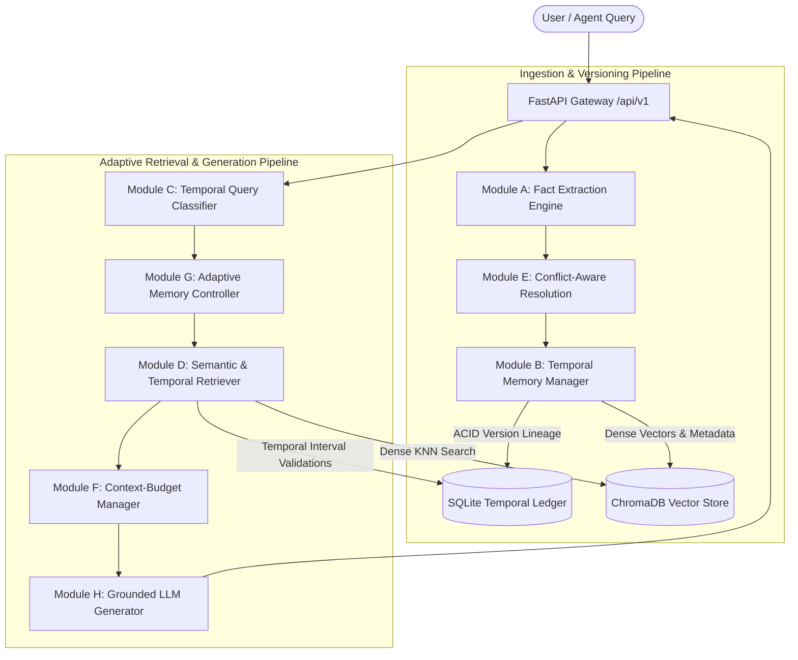

# MEMO-EXI: Adaptive Temporal Memory Management for LLM Agents

[](https://fastapi.tiangolo.com)
[](https://streamlit.io)
[](https://www.trychroma.com)
[](https://www.sqlite.org)
[](https://www.python.org)
[](https://pytest.org)

**MEMO-EXI** is an adaptive, non-destructive, version-aware temporal memory engine designed for LLM agents. Unlike naive key-value memory stores that overwrite historical states or traditional vector RAG architectures that hallucinate stale information, MEMO-EXI couples an ACID-compliant **SQLite temporal ledger** with a **ChromaDB vector store** under the coordination of an **Adaptive Memory Controller**, **Temporal Query Classifier**, **Conflict-Aware Resolution Engine**, and **Context-Budget Manager**.

---

## 🏗️ Architecture Overview



---

## ⚡ Core Modules

- **Module A: Ingestion & Fact Extraction**: Parses natural dialogue turns into structured tuples `(subject, attribute, value, memory_type, confidence, importance)`. Filters ephemeral chitchat.
- **Module B: Temporal Memory Manager**: Performs non-destructive, version-aware updates. Superseded records are tagged with `valid_until` timestamps and chained to new records via `supersedes_id`.
- **Module C: Temporal Query Classifier**: Classifies incoming queries into 5 intents (`current_state`, `historical`, `temporal`, `general_semantic`, `ambiguous`) and extracts point-in-time constraints.
- **Module D: Semantic Memory Retrieval**: Executes vector search in ChromaDB, joined with authoritative SQLite metadata, applying strict status and interval filters ($valid\_from \le t < valid\_until$).
- **Module E: Conflict-Aware Resolution**: Differentiates between legitimate chronological state updates and unresolved contradictions, generating clarification requests for disputed records.
- **Module F: Context-Budget Manager**: Formulates candidate memory utility:
  $$U(m, q) = w_{rel} S_{rel} + w_{temp} S_{temp} + w_{imp} I(m) - w_{red} R(m)$$
  and greedily packs memories within a configurable token budget $B_{tokens}$.
- **Module G: Adaptive Memory Controller**: Dynamically adjusts retrieval parameters (top-$k$, filters, query reformulation on sparse/poor recall).
- **Module H: LLM Response Generation**: Synthesizes grounded answers strictly delineating active current facts, historical states, disputed facts, and missing data.

---

## 🚀 Quickstart & How to Run

### 1. Prerequisites & Environment Setup
Clone the repository and ensure you are using Python 3.10+:

```bash
git clone https://github.com/prranavii/Memo-exi.git
cd Memo-exi

# Create and activate virtual environment
python -m venv venv
# On Windows:
.\venv\Scripts\activate
# On Linux/macOS:
source venv/bin/activate

# Install required dependencies
pip install -r requirements.txt
```

### 2. Configure Environment Variables
Copy `.env.example` to `.env`:

```bash
cp .env.example .env
```

Key environment settings inside `.env`:
```env
# Groq API Configuration (or uses offline deterministic mock fallback if unset)
GROQ_API_KEY=your_groq_api_key_here
GROQ_MODEL=llama-3.3-70b-versatile

# Storage Paths
SQLITE_DB_PATH=./data/memo_exi.db
CHROMA_PERSIST_DIR=./data/chroma_storage
CHROMA_COLLECTION_NAME=memo_exi_vectors
EMBEDDING_MODEL_NAME=all-MiniLM-L6-v2

# Context Budget & Weights
DEFAULT_TOKEN_BUDGET=1024
DEFAULT_TOP_K=5
```

---

## 🖥️ Running the Application

### Option A: Run the Streamlit Interactive Dashboard
The Streamlit dashboard provides a comprehensive visual UI with Chat, Memory Explorer, Temporal History, Conflict Monitor, Retrieval Analytics, and System Configuration tabs:

```bash
streamlit run app.py
```
Open your browser at `http://localhost:8501`.

#### Streamlit Dashboard Features:
1. **💬 Chat Interface**: Test natural conversations, live fact ingestion, point-in-time questions, and inspect real-time execution traces.
2. **🔍 Memory Explorer**: Filter persistent SQLite memories by status (`current`, `superseded`, `disputed`) and type (`preference`, `factual`, `constraint`, `episodic`).
3. **⏳ Temporal History**: Select any entity & attribute to view step-by-step chronological evolution and lineage graphs.
4. **⚠️ Conflict Monitor**: Inspect conflicting assertions and resolve disputed facts with one click.
5. **📊 Retrieval Analytics**: Live charts of memory distributions and telemetry.
6. **⚙️ System Configuration**: Live slider controls for token budget $B_{tokens}$ and utility weights ($w_{rel}, w_{temp}, w_{imp}, w_{red}$).

---

### Option B: Run the FastAPI Backend Server
To run the REST API with auto-reload:

```bash
uvicorn memo_exi.api.main:app --host 0.0.0.0 --port 8000 --reload
```
Interactive Swagger API documentation is available at:
👉 **`http://localhost:8000/docs`**

---

## 📡 REST API Reference

| Method | Endpoint | Description |
|---|---|---|
| `POST` | `/api/v1/conversations` | Process natural conversation turn end-to-end |
| `POST` | `/api/v1/memories/extract` | Extract structured facts without persisting |
| `POST` | `/api/v1/memories` | Explicitly store a structured memory |
| `GET` | `/api/v1/memories` | Query memories with temporal & relational filters |
| `GET` | `/api/v1/memories/{memory_id}` | Retrieve memory with forward/backward lineage |
| `GET` | `/api/v1/memories/history` | Retrieve complete version history for `(subject, attribute)` |
| `POST` | `/api/v1/memories/update` | Version-aware update (marks old superseded, creates new) |
| `POST` | `/api/v1/retrieval/search` | Vector search, temporal routing, budget optimization |
| `POST` | `/api/v1/chat` | Generate grounded answer from retrieved memories |
| `GET` | `/api/v1/analytics` | Return database counts, vector stats, and health |
| `POST` | `/api/v1/evaluation/run` | Execute 10 benchmark scenarios across baselines & ablations |

---

## 🧪 Running Tests

To run the complete test suite across all 8 phases:

```bash
pytest tests/ -v
```

---

## 📊 Benchmark & Evaluation Framework

MEMO-EXI evaluates 10 core scenarios against 5 baseline systems and 4 ablation variants:

### Baseline Comparisons:
- **B0**: No persistent memory (zero-shot prompt only)
- **B1**: Recent-History baseline (sliding window of last $N$ turns)
- **B2**: Fixed Semantic Retrieval (standard vector RAG without temporal filters)
- **B3**: Temporal Retrieval without Adaptive Control
- **P**: Proposed **MEMO-EXI** system

### Ablation Studies:
- **A1**: Disable versioning (direct in-place overwrite)
- **A2**: Disable temporal routing (treat all queries as general semantic)
- **A3**: Disable conflict resolution (unconditional updates)
- **A4**: Disable context-budget manager (unconstrained $k$)

To trigger benchmarks via API:
```bash
curl -X POST http://localhost:8000/api/v1/evaluation/run -H "Content-Type: application/json" -d "{}"
```

---

## 📄 License
MIT License. Developed for research and production-grade LLM agent memory architectures.
